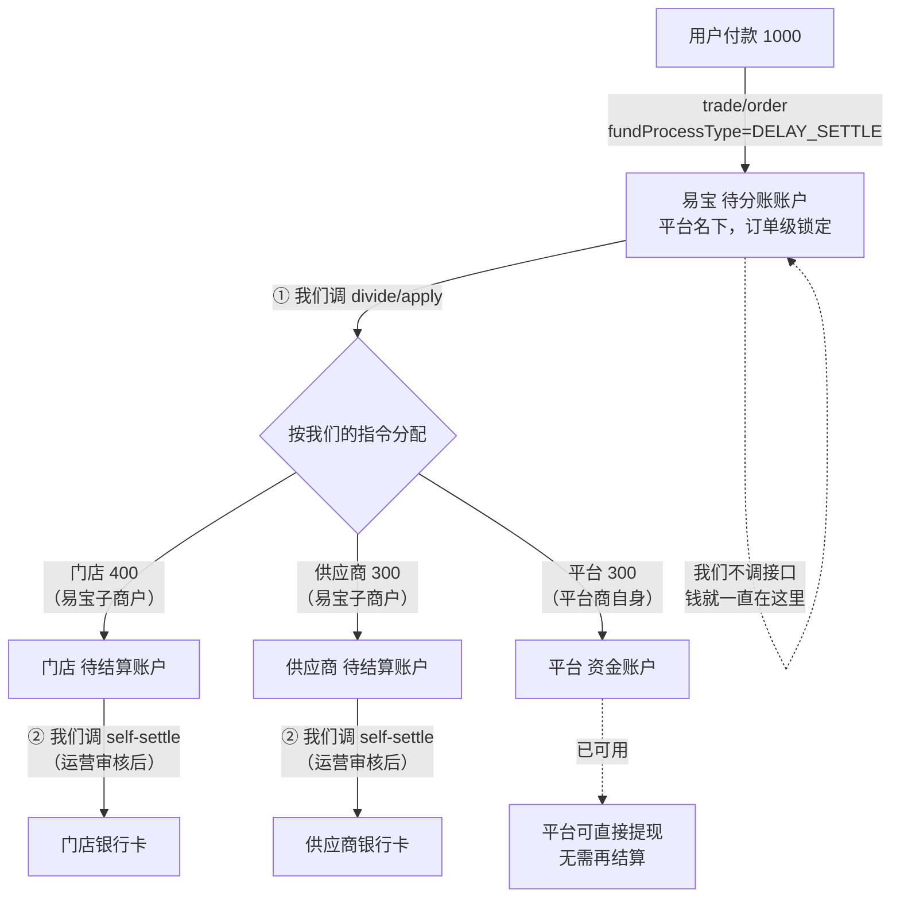
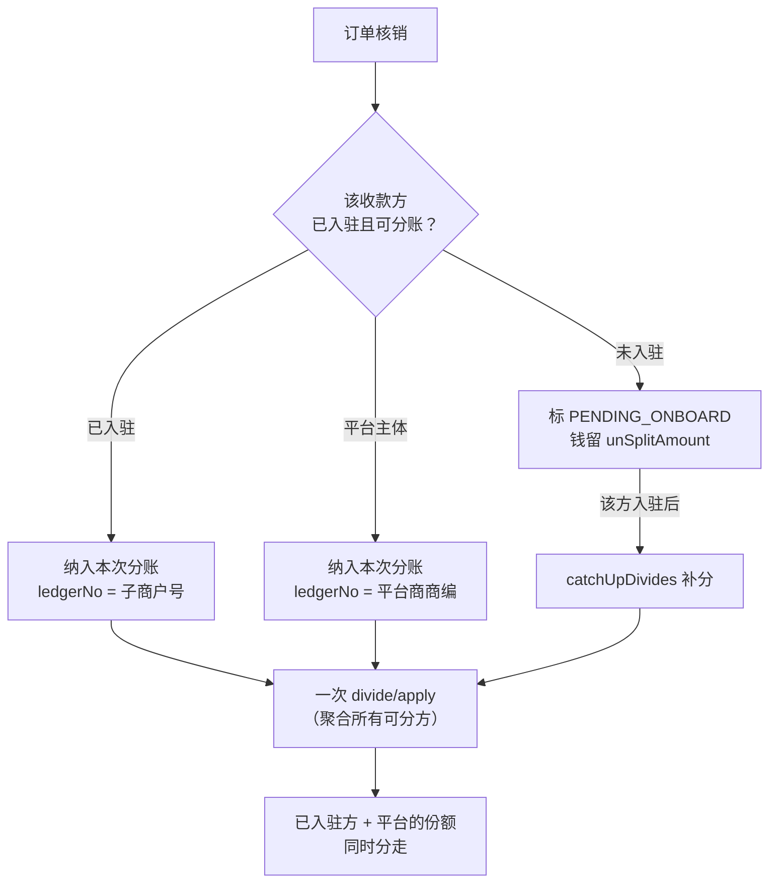
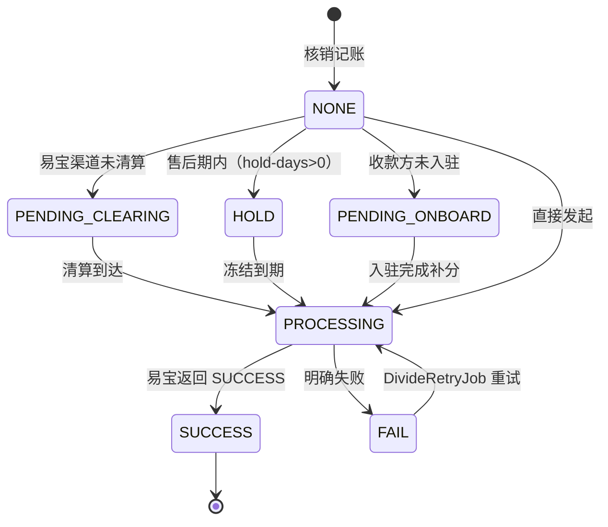
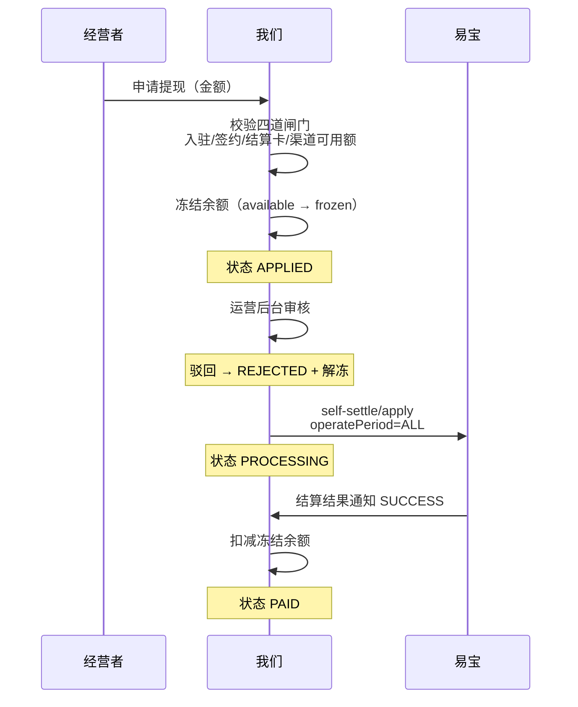
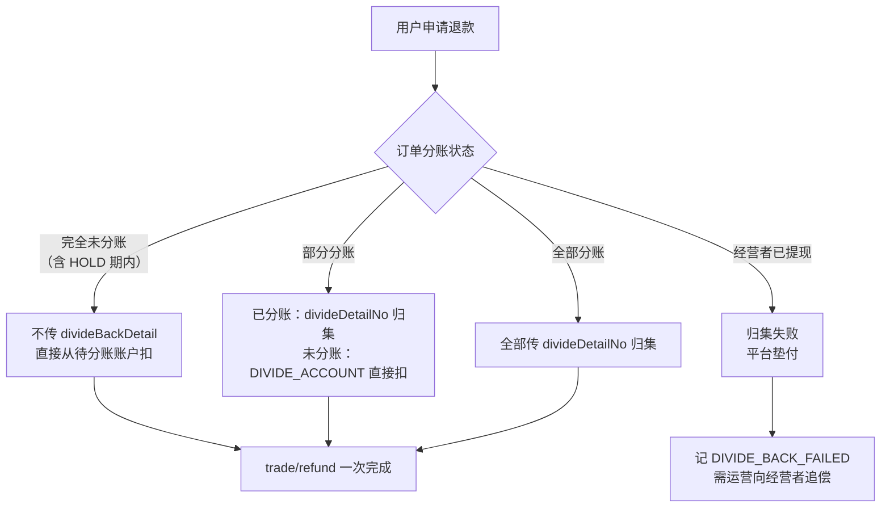
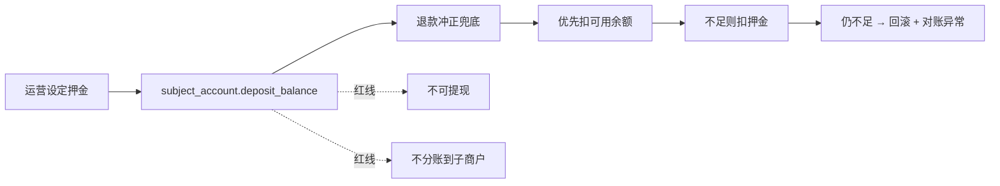

# 易宝支付资金流程

> 本文档描述易宝支付在本项目中的完整资金流转，**内容已与代码实现逐条核对**（2026-11-23）。
>
> 关键结论：**易宝不会自动动钱**。分账、结算全部由我们主动调用接口触发（已确认子商户全部配置为「自助结算」）。

## 一、一句话概括

```
下单标记分账 → 钱进「待分账账户」（我们不动就一直在）
→ 我们调 divide/apply → 经营者进「待结算账户」、平台进「资金账户」
→ 经营者提现：运营审核通过后我们调 self-settle → 打到银行卡
```

## 二、易宝的账户结构

易宝侧有**四类账户**，理解它们是理解整个流程的前提：

| 账户 | 谁能用 | 说明 |
|---|---|---|
| **待分账账户** | 平台商 | 下单标记 `DELAY_SETTLE` 后钱进这里，**按订单锁定**，平台也动不了 |
| **待结算账户** | 各子商户 | `divide/apply` 分账后，经营者份额进这里，需结算才能到卡 |
| **资金账户** | 平台商自身 | 平台自己的份额分账后**直接进这里**，无需再结算 |
| **手续费账户** | 平台商 | 手续费扣减，业务不直接操作 |

## 三、完整资金流



**两个关键节点都必须由我们主动调接口**：

1. **`divide/apply`** —— 不调，钱永远停在待分账账户
2. **`self-settle`** —— 不调，经营者的钱永远停在待结算账户

## 四、代码实现对照

每一个环节在代码里的落点：

| 环节 | 触发时机 | 代码位置 | 易宝接口 |
|---|---|---|---|
| 下单标记分账 | 用户点支付 | `YeepayPaymentGateway#createOrder` | `POST /rest/v1.0/trade/order` |
| 换取唤起参数 | 同上 | `YeepayPaymentGateway#prepayWithToken` | `POST /rest/v1.0/aggpay/pre-pay` |
| 支付结果入账 | 易宝回调 | `YeepayNotifyService#handlePayNotify` | — |
| 清算状态更新 | 易宝回调 | `OrderDivideService#onClearingSuccess` | — |
| **发起分账** | **订单核销后** | `OrderDivideService#divideForOrder` | `POST /rest/v1.0/divide/apply` |
| 平台份额落回 | 各方分完后（残差） | `YeepayDivideService#complete` | `POST /rest/v1.0/divide/complete` |
| 发起提现 | 运营审核通过 | `YeepayPayoutGateway#transfer` | `POST /rest/v1.0/settle/self-settle/apply` |

**下单参数实证**（`YeepayPaymentGateway.java:146`）：

```java
// 延迟分账：钱进待分账账户，等待 divide/apply
params.put("fundProcessType", "DELAY_SETTLE");
```

**分账触发实证**（`OrderVerifiedSplitConsumer.java:95`）：

```java
ledgerService.executeSplit(...);           // ① 本地记账
orderDivideService.divideForOrder(...);    // ② 紧接着调易宝分账
```

## 五、已确认的关键配置

| 配置项 | 结论 | 影响 |
|---|---|---|
| 分账规则控制方式 | 下单接口的 `fundProcessType` 字段 | 非易宝后台配置，由代码控制 |
| 平台份额去向 | **平台资金账户** | 平台的钱分账后即可用，无需再结算 |
| 经营者子商户结算方式 | **全部配置为「自助结算」** | 必须我们调 `self-settle` 才打款，运营审核不会被绕过 |

**「自助结算」是最关键的外部配置**：若配成「自动结算」，分账到账后次日会自动打款到经营者卡，**完全绕过平台的提现审核**。

## 六、分账的分配规则

一笔订单可能有五个收款方（门店 / 渠道 / 投资人 / 供应商 / 团长）加平台。



**为什么要聚合**：易宝对同一订单有分账次数上限（`OPR21006`）。一次请求把所有可分方放在同一个 `divideDetail` 数组里，避免触顶。

**平台份额先分走的意义**：平台不用等所有经营者都入驻就能拿到自己的钱，否则订单会长期卡在「部分分账」，平台现金流被冻结。

## 七、分账状态机

`settlement_record.divide_status` 的流转：



| 状态 | 含义 | 会自动重试吗 |
|---|---|---|
| `PENDING_CLEARING` | 支付成功但清算未完成，易宝拒绝分账（`OPR21016`） | 是（清算通知或定时任务） |
| `HOLD` | 售后期冻结，钱留待分账账户 | 是（到期后） |
| `PENDING_ONBOARD` | 收款方未入驻 | 是（入驻后或定时任务） |
| `PROCESSING` | 请求已发出，结果未知 | **否**——重发会重复分账 |
| `SUCCESS` | 钱已到接收方账户 | 终态 |
| `FAIL` | 明确失败 | 是 |

**`PROCESSING` 绝不重试**，这是资金安全红线：结果未知时重发会导致同一笔钱分两次。

## 八、提现流程



**四道闸门**（缺一不可）：

1. 入驻状态 `COMPLETED`
2. 协议已签署
3. 结算卡已绑定
4. 该渠道可用额充足

**状态机**：

```
APPLIED → PROCESSING → PAID
        ↘ REJECTED（解冻）
        ↓
    PROCESSING → FAILED（解冻）
```

**补偿任务**：`PayoutReconcileJob` 每 5 分钟扫 `PROCESSING` 主动查单，防回调丢失导致提现永久卡死。

## 九、退款流程

退款任何时候都能发起，处理方式取决于订单的分账状态：



**为什么用 `divideBackDetail` 而不是先调 `divide/back`**：易宝的退款接口自带归集参数，一次请求完成「归集 + 退款」，比分两次调少一个失败点、少一个中间态。

**归集的两条互斥约束**（易宝文档）：

- 归集明细（带 `divideDetailNo`）**不得**带 `divBackAccountType`
- 收单商户明细（带 `divBackAccountType`）**不得**带 `amount`，且**最多一条**

**售后期冻结（`hold-days`）的价值**：冻结期内钱还在待分账账户，退款走最简单路径（不需要归集、不需要追讨）。`hold-days=0` 时退化为「核销即分账」。

## 十、押金的定位



押金是**纯本地账本额度**，对应的钱留在平台侧，只有「退款抵扣」一个出口。

**为什么不能分账到子商户**：钱一旦进经营者子商户账户，他可以在易宝后台自行结算提走，押金就失去兜底作用。

## 十一、与微信支付的关系

两条链路**完全独立**，互不影响：

| 关注点 | 微信（保持不动） | 易宝（新增） |
|---|---|---|
| Bean 装配开关 | `app.pay.wxpay.channel=wxpay` | `app.pay.yeepay.channel=yeepay` |
| 新订单收款 | `COLLECT_CHANNEL=wxpay` | `COLLECT_CHANNEL=yeepay` |
| 出款 | `PAYOUT_CHANNEL=wxpay` | `PAYOUT_CHANNEL=yeepay` |
| 回调路径 | `/api/v1/app/payments/wxpay/**` | `/api/v1/app/yeepay/notify/**` |
| 退款路由 | 按 `payment.channel` 回原通道 | 同左 |

**红线**：`PAY_CHANNEL` 与全部 `WXPAY_*` 一个字符都不能改。一旦改成 `yeepay`，微信 Bean 消失，**历史微信订单的退款会全部失败**。

## 十二、兜底任务

| 任务 | 频率 | 职责 |
|---|---|---|
| `PayoutReconcileJob` | 每 5 分钟 | 扫 `PROCESSING` 提现查单，防回调丢失 |
| `DivideRetryJob` | 每 2 小时 | 重试 `FAIL` / `PENDING_ONBOARD` / 到期 `HOLD` / 已清算的 `PENDING_CLEARING` |

`DivideRetryJob` 的扫描范围刻意**排除 `PROCESSING`**——那是「已发出、结果未知」，需要靠查询确认而不是重发。

## 十三、待办与前置条件

| 事项 | 状态 | 影响 |
|---|---|---|
| **平台商商编开通** | 待易宝开通 | **阻塞分账**：未配置时平台份额无法分走 |
| 易宝 appKey / 商编 / 私钥 | 待配置 | 现在可在运营后台「平台主体」页填写 |
| 子商户配「自助结算」 | 已确认全部配置 | — |
| `APP_SENSITIVE_KEY` | 待注入 | 后台保存商户私钥必需 |

**平台商商编未到位时的表现**：分账时平台那部分标 `PENDING_ONBOARD` 留在 `unSplitAmount`——经营者的钱能正常分，平台的钱暂时拿不到。等商编配好，`catchUpDivides` 会自动补分。

## 十四、常见误解澄清

| 误解 | 实际 |
|---|---|
| 「易宝会自动分账」 | 不会。不调 `divide/apply`，钱永久停在待分账账户 |
| 「分账完钱就到经营者卡了」 | 不对。分账只到「待结算账户」，还要 `self-settle` 才到卡 |
| 「平台份额也要走结算」 | 不用。平台份额直接进资金账户，已可用 |
| 「待结算账户和待分账账户是一个」 | 不是。前者属于各子商户，后者属于平台商 |
| 「退款要先调 divide/back」 | 不用。退款接口自带 `divideBackDetail` 参数一次完成 |

---

## 附录：相关文档

| 文档 | 内容 |
|---|---|
| [易宝对接-部署与配置说明.md](./易宝对接-部署与配置说明.md) | 环境变量、后台配置、灰度与回滚 |
| [易宝对接-商务确认清单.md](./易宝对接-商务确认清单.md) | 与易宝确认的商务事项 |
| [易宝收款-联调清单.md](./易宝收款-联调清单.md) | 联调步骤与待验证假设 |
