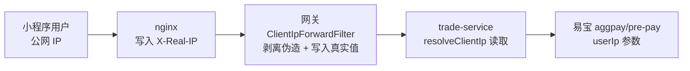

# 易宝收款联调清单

> 目的：用沙箱或小额真实订单跑通「下单 → 支付 → 清算 → 核销分账 → 提现」全链路，
> 并确认代码里几处只能靠真实响应验证的假设。
>
> 建立日期：2026-11-21

## 一、联调前准备

| 项            | 检查内容                                                                                        |
| ------------- | ----------------------------------------------------------------------------------------------- |
| 环境变量      | `YEEPAY_CHANNEL=yeepay`、`APP_KEY`、`MERCHANT_NO`、`PLATFORM_MERCHANT_NO`、`PRIVATE_KEY` 已注入 |
| 通道开关      | `COLLECT_CHANNEL=yeepay`、`PAYOUT_CHANNEL=yeepay`                                               |
| `PAY_CHANNEL` | **保持原值不动**（如 `wxpay`），否则微信退款会失败                                              |
| 易宝后台      | 小程序 AppID 已配置、微信小程序支付产品已开通                                                   |
| 网关注入      | `ClientIpForwardFilter` 已生效（见下）                                                          |

### 用户真实 IP 的透传链路



**验证方法**：下单后看 trade-service 日志

```
下单 IP 解析 clientIp=203.0.113.7 xff=203.0.113.7 realIp=203.0.113.7 remoteAddr=172.18.0.5
```

- `clientIp` 应为你手机的公网 IP（可用 `curl ifconfig.me` 对比）
- 若 `clientIp` 是 `172.x` / `10.x` / `192.168.x`，说明网关过滤器未生效

**安全说明**：网关**不信任**客户端传入的 `X-Forwarded-For`（可伪造），只信任两类来源：
① 上游 nginx 的 `X-Real-IP`；② 网关自己的 TCP 对端地址。

### 平台商商编是阻塞项

`YEEPAY_PLATFORM_MERCHANT_NO` 未配置时：

- 启动日志会打 **ERROR**：`易宝已启用但未配置 platform-merchant-no：平台份额将无法分账`
- 分账时平台份额会被标 `PENDING_ONBOARD`，整笔订单卡在「部分分账」
- **平台自己的钱拿不到，订单也无法 `divide/complete` 完结**

**收款不受影响**（收款不需要平台商商编），但分账与提现必须等它开通。

向易宝申请时的说法：

> 我们是 SaaS 服务商（已有服务商主商编），需要在其下开通一个「平台商」子商户，
> 用于 ① 作为经营者的 `parentMerchantNo`；② 作为分账发起方与平台份额的接收方。
> 该平台商户需开通「订单分账」与「提现/结算」产品。

## 二、必须验证的 5 个假设

这 5 项都是代码里**只能靠真实响应确认**的，联调时逐项核对。

### 假设 1：`trade/order` 返回 token

**代码位置**：`YeepayPaymentGateway#createOrder`

**预期**：响应含 `code=OPR00000` 与 `token`

**若失败**：查日志 `易宝建单失败 orderNo=... code=... msg=...`

**要记录的**：完整响应 JSON（脱敏后），特别是 `token` 与 `uniqueOrderNo`

---

### 假设 2：`aggpay/pre-pay` 返回的字段名

**代码位置**：`YeepayPaymentGateway#prepayWithToken`

**这是最需要确认的一项**。代码已对以下字段做多候选匹配：

| 目标字段  | 候选名                                       |
| --------- | -------------------------------------------- |
| appId     | `appId` / `appid` / `app_id`                 |
| timeStamp | `timeStamp` / `timestamp` / `time_stamp`     |
| nonceStr  | `nonceStr` / `noncestr` / `nonce_str`        |
| package   | `package` / `packageValue` / `prepayPackage` |
| signType  | `signType` / `signtype` / `sign_type`        |
| paySign   | `paySign` / `pay_sign` / `sign`              |

**若全部候选都没命中**，日志会打出：

```
易宝预下单响应缺少小程序唤起参数 orderNo=... 响应={...}
```

**拿到真实响应后要做的**：

1. 确认字段名与候选是否一致
2. 若不一致，在 `firstText(...)` 的候选列表里补上真实字段名
3. **若字段名与微信完全一致**（`appId` / `timeStamp` / `nonceStr` / `package` / `signType` / `paySign`），
   则小程序端 `wx.requestPayment` **一行都不用改**

---

### 假设 3：`divide/apply` 响应含 `divideDetailNo`

**代码位置**：`YeepayDivideService#parseDetails`

**为什么关键**：退款归集要求传明细级单号，没有它就**无法归集已分账的钱**。

**预期**：`divideDetail` 是 JSON 数组，每项含 `divideDetailNo`

**若响应不含该字段**：

- 日志会打 `分账响应未返回 divideDetailNo，该笔退款将无法归集`
- 此时需要退化方案：分账后调 `divide/query` 补查明细
- 检查数据库：`select yeepay_divide_detail_no from settlement_record where order_id = ?`

---

### 假设 4：清算通知的到达时机

**代码位置**：`YeepayNotifyService#forwardClearingNotify` → `OrderDivideService#onClearingSuccess`

**验证方法**：

1. 下单并支付
2. 核销订单（触发分账）
3. 查 `settlement_record.divide_status`：
   - 若为 `PENDING_CLEARING` → 说明核销早于清算，门禁生效，等清算通知
   - 若已 `SUCCESS` → 说明支付后清算很快，门禁未触发
4. 等清算通知到达，再看 `divide_status` 是否转为 `SUCCESS`

**要记录的**：支付成功到清算通知的时间差（判断是否需要给用户「清算中」提示）

---

### 假设 5：平台商自收分账是否被接受

**代码位置**：`OrderDivideService#receiverMerchantNo`

**背景**：平台主体没有入驻记录，代码直接用 `PLATFORM_MERCHANT_NO` 作为 `ledgerNo`，
形成「平台商给自己分账」（`merchantNo == ledgerNo`）。你已确认易宝允许。

**验证方法**：看分账日志是否含平台主体的 `ledgerNo`，以及 `divide/apply` 是否 `code=OPR00000`

**若被拒绝**：错误码会是 `OPR00001 商户关系有误` 或类似，此时平台份额只能退回 `divide/complete`

---

## 三、完整链路验证步骤

### 步骤 1：下单

```
POST /api/v1/app/orders/{orderNo}/pay
```

**检查**：

- 返回 `prepayId` 与 `params`
- `params` 含 6 个字段且非空
- 数据库 `payment` 表有 `channel='YEEPAY'` 记录

### 步骤 2：小程序支付

**若 `params` 字段名与微信一致**：现有代码直接可用
**若不一致**：需改小程序支付页（见假设 2）

**检查**：`wx.requestPayment` 能成功唤起收银台

### 步骤 3：支付回调

**检查日志**：`易宝支付入账完成 orderNo=... uniqueOrderNo=...`

**检查数据库**：

- `orders.pay_status = 'PAID'`
- `payment.standard_status = 'PAID'`、`channel = 'YEEPAY'`

### 步骤 4：清算通知

**检查日志**：`已转发清算通知 orderNo=... status=SUCCESS ypSettleAmount=...`
与 `订单清算完成，触发分账 orderNo=...`

**检查数据库**：

```sql
select divide_status, clearing_status, fund_channel
from settlement_record where order_no = '<orderNo>';
```

预期 `clearing_status=SUCCESS`、`fund_channel=YEEPAY`

### 步骤 5：核销分账

**检查日志**：`订单分账已受理 orderNo=... 接收方数=... status=SUCCESS 明细数=...`

**检查数据库**：

```sql
select subject_id, amount, divide_status, divided_amount,
       yeepay_divide_detail_no, fund_channel
from settlement_record where order_no = '<orderNo>';
```

**要点**：

- 平台主体的 `divide_status` 应为 `SUCCESS`（平台份额先分走）
- 未入驻经营者的应为 `PENDING_ONBOARD`
- `yeepay_divide_detail_no` 非空

### 步骤 6：提现

**前置**：经营者已入驻 + 已绑结算卡

**检查**：提现申请 → 后台审核 → 结算回调 → `withdrawal.status = 'PAID'`

### 步骤 7：退款（关键用例）

分三种情况各测一次：

| 场景         | 操作                           | 预期                                            |
| ------------ | ------------------------------ | ----------------------------------------------- |
| 未分账退款   | 售后期内（`HOLD`）退款         | `divideBackDetail` 不传，直接退成功             |
| 部分分账退款 | 平台已分账、经营者未入驻时退款 | 数组含 `divideDetailNo` + `DIVIDE_ACCOUNT` 两条 |
| 已分账已提现 | 全额分账后经营者提现，再退款   | 归集失败 → 平台垫付 → 记 `DIVIDE_BACK_FAILED`   |

**检查对账池**：

```sql
select * from reconcile_issue where issue_type = 'DIVIDE_BACK_FAILED';
```

---

## 四、常见问题排查

| 现象                     | 可能原因                         | 处置                                 |
| ------------------------ | -------------------------------- | ------------------------------------ |
| 下单报「商户产品未开通」 | 易宝后台未配置小程序支付或 AppID | 联系易宝配置                         |
| 下单报 `userIp` 相关错误 | 网关未透传 `X-Forwarded-For`     | 检查网关过滤器                       |
| 分账报 `OPR21016`        | 清算未完成就分账                 | 门禁应已拦住，检查 `clearing_status` |
| 分账报 `OPR00001`        | 平台商自收被拒                   | 见假设 5，改用 `divide/complete`     |
| 退款报 `OPR21033`        | 归集金额超限（经营者已提现）     | 走平台垫付 + 追偿                    |
| 回调一直重试             | 没回写纯文本 `SUCCESS`           | 检查 controller 返回值               |
| 微信退款突然全部失败     | `PAY_CHANNEL` 被改成了 `yeepay`  | **改回 `wxpay`**，微信 Bean 需常驻   |

---

## 五、联调后要回填的代码

| 项           | 位置                                   | 说明                         |
| ------------ | -------------------------------------- | ---------------------------- |
| 小程序支付页 | `user-h5` 支付调用处                   | 若字段名不一致才需要改       |
| 字段候选名   | `YeepayPaymentGateway#prepayWithToken` | 补上真实字段名               |
| 清算时延提示 | `user-h5` 收益页                       | 若时延较长，加「清算中」文案 |

---

## 六、灰度与回滚

**灰度顺序**

1. `COLLECT_CHANNEL=wxpay` 上线代码（仅部署，行为不变）
2. 内部账号小额下单，`COLLECT_CHANNEL=yeepay`
3. 确认全链路通后，按用户比例放量

**回滚**

```bash
COLLECT_CHANNEL=wxpay     # 停止新订单走易宝
```

历史易宝订单不受影响：退款与查单仍按 `payment.channel` 回原通道（微信 Bean 常驻，反之亦然）。

**不要回滚的东西**：V119 迁移（已加的列保留，回滚代码不影响数据）。
